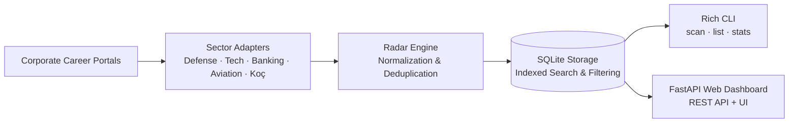

<div align="center">
  
</div>

# Kariyer Radar — Multi-Sector Job Aggregation Engine & FastAPI Dashboard

[](https://python.org)
[](https://fastapi.tiangolo.com)
[](https://sqlite.org)
[](https://docker.com)

Modular Python job-portal aggregation engine, SQLite persistence layer, Rich CLI, and FastAPI web dashboard for monitoring engineering, defense, fintech, aviation, and enterprise openings across major corporate career portals.

## Architecture



## Key Features

- **Pluggable Adapter Pattern (`radar/adapters/`):** Isolated sector adapters (Tech, Defense, Banking, Aviation, Enterprise Holding) with resilient parsing and standardized `JobPosting` models.
- **Deduplicated SQLite Storage (`radar/storage.py`):** Upsert-safe persistence with fast sector, company, and keyword search filtering.
- **CLI & FastAPI Dashboard (`main.py`, `radar/web/`):** Run scheduled scans from the terminal with Rich formatting or browse live results over FastAPI + Uvicorn.
- **Automated Test Suite (`tests/test_radar.py`):** Unit tests covering storage CRUD, deduplication, search/filtering, and adapter verification.

## Quick Start

```bash
git clone https://github.com/Bugraciftci/kariyer-radar.git
cd kariyer-radar
python3 -m venv .venv && source .venv/bin/activate
pip install -r requirements.txt
```

### Run CLI & Web Dashboard

```bash
# Scan portals and persist openings to SQLite
python3 main.py scan

# Launch FastAPI dashboard on http://127.0.0.1:8000
python3 main.py serve
```

### Run with Docker

```bash
docker build -t kariyer-radar .
docker run -p 8000:8000 kariyer-radar
```

### Run Tests

```bash
python3 -m unittest discover -s tests -v
```

## License

MIT — see [LICENSE](./LICENSE).
